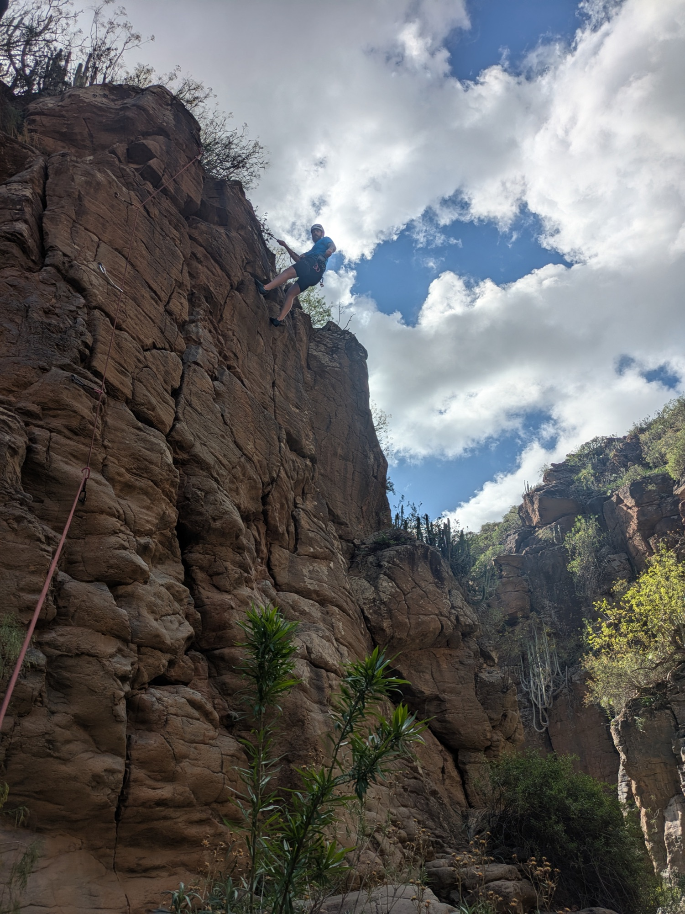

## Wie es sich anfühlt

Die meisten kommen etwas nervös an und fragen beim Gehen, wann sie wiederkommen können. Die ersten Züge fühlen sich ungewohnt an: das Seil, das sanft am Gurt zieht, der raue Vulkanfels unter den Fingern und der Boden, der langsam weiter weg rückt. Dein Guide begleitet dich bei jedem Schritt, von der Fußposition bis zu dem Moment, in dem du dem Seil vertraust und dich zurücklehnst. Und dann, irgendwo in der zweiten oder dritten Route, macht es Klick. Du hörst auf zu klammern und fängst an zu klettern, und oben belohnt dich der Blick über den Süden Teneriffas.

**Du bist die ganze Zeit sicher.** Du kletterst im Toprope, das Seil ist also über dir verankert und fängt dich sofort, wenn du abrutschst. Dein Guide legt dir Gurt und Helm an, prüft jeden Knoten und sichert oder beaufsichtigt jede Route.

## Was du machst

1. **Du triffst deinen Guide** am Treffpunkt in der Nähe des Felsens. Wir prüfen deine Schuhgröße und passen Gurt und Helm an.
2. **Sicherheitseinweisung.** Du lernst, wie das Seilsystem funktioniert, den Achterknoten und die Kletterkommandos.
3. **Erste Routen.** Du kletterst leichte, gut abgesicherte Routen im Toprope, während dein Guide dich sichert und dir Tipps zur Fußtechnik gibt.
4. **Sichern lernen** (optional). Wenn du möchtest, lernst du unter Aufsicht des Guides, einen Partner zu sichern.
5. **Schwerere Routen.** Mit wachsendem Selbstvertrauen probierst du eine steilere oder längere Route.
6. **Nachbesprechung.** Wir geben dir Tipps zu deiner Technik und dazu, wo und wie du weiterklettern kannst, und nennen dir die nächsten Kurse, um weiter Fortschritte zu machen, falls du Feuer gefangen hast.

## Für wen es ist

- Absolute Anfänger, die Klettern am echten Fels ausprobieren wollen
- Hallenkletterer, die noch nie draußen geklettert sind
- Paare, Freunde und Reisende, die einen aktiven halben Tag auf Teneriffa suchen

## Wo wir klettern

Meist nutzen wir die leichten, gut abgesicherten Sektoren rund um [Tamadaya](/de/klettergebiete/tamadaya/) und [Arico](/de/klettergebiete/arico/) im sonnigen Süden der Insel. Im Sommer starten wir früh, um der Hitze auszuweichen.
