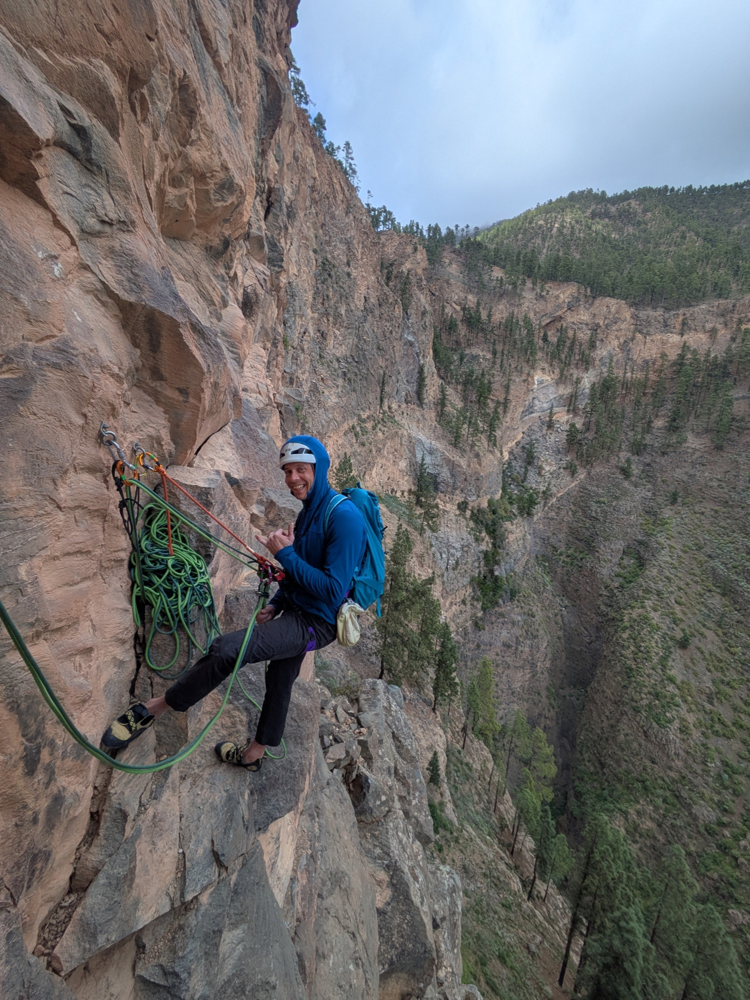

## Wie es sich anfühlt

Lange Abenteuerrouten fühlen sich anders an als jede andere Disziplin. Die Seilschaft, die Kameradschaft, die Höhe unter den Füßen, die Standplätze mitten in der Wand und der Ausstieg am Gipfel machen das Erlebnis unvergesslich. Auf Teneriffa gibt es zahlreiche Möglichkeiten, an der Küste wie im Inselinneren.

**Lange Routen erfordern Erfahrung.** Unser leitender Guide ist Técnico Deportivo Superior en Escalada (TD3) und hat lange Abenteuerrouten von Yosemite bis Kirgistan geklettert. Es sind immer höchstens zwei Kletterer pro Guide, so ist jeder Tag auf die Wünsche und das Niveau jedes Teilnehmers zugeschnitten.

## Die Routen

Von den Wänden in Arico über die Küste bei Taganana bis in den Teide-Nationalpark: Wir wählen die Route nach deinem Niveau, dem Wetter und dem Andrang an der Wand. In unseren [Klettergebieten](/de/klettergebiete/) lernst du die Insel kennen.

## Wie der Tag abläuft

1. Früher Start. Wir treffen uns und fahren zum Zustieg.
2. Materialcheck und Einweisung in die Seiltechnik: Standplätze, Kommunikation und Abseilen.
3. Die Kletterei, mit deinem Guide im Vorstieg oder im Wechsel, wenn du die Erfahrung hast.
4. Abstieg per Abseilen oder zu Fuß, dann Nachbesprechung.

## Für wen es ist

Kletterer, die Einseillängen im Sportklettern schon genießen und das größere Abenteuer einer langen Route suchen, und Seilschaften, die für ihre erste Mehrseillänge auf Teneriffa einen lokalen Guide wollen.
