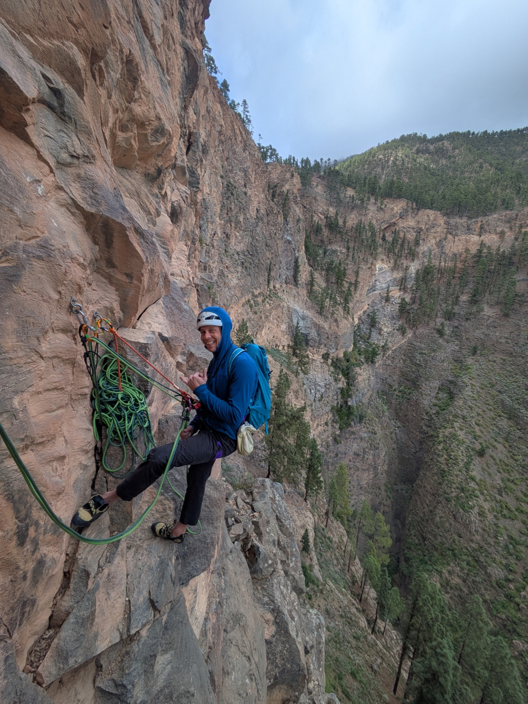

## What it feels like

Long adventure routes feel different from any other kind of climbing. The rope team, the companionship, the height beneath your feet, the belays halfway up the wall and reaching the top make it an unforgettable experience. Tenerife has plenty of options, both on the coast and inland.

**Long routes need experience.** Our lead guide is a Técnico Deportivo Superior en Escalada (TD3) who has climbed long adventure routes from Yosemite to Kyrgyzstan. It's always two climbers per guide at most, so every day is tailored to each climber's needs and level.

## The routes

From the walls of Arico to the coast at Taganana and Teide National Park, we choose the route for your level, the weather and how busy the wall is. See our [climbing areas](/climbing-areas/) to get to know the island.

## How the day works

1. Early start. We meet and drive to the approach.
2. Gear check and a rope work briefing: belays, communication and abseils.
3. The climb, with your guide leading or swapping leads if you have the experience.
4. Descent by abseil or walk-off, then a debrief.

## Who it's for

Climbers who already enjoy single-pitch sport climbing and want the bigger adventure of a long route, and teams who want a local guide on their first multi-pitch in Tenerife.
