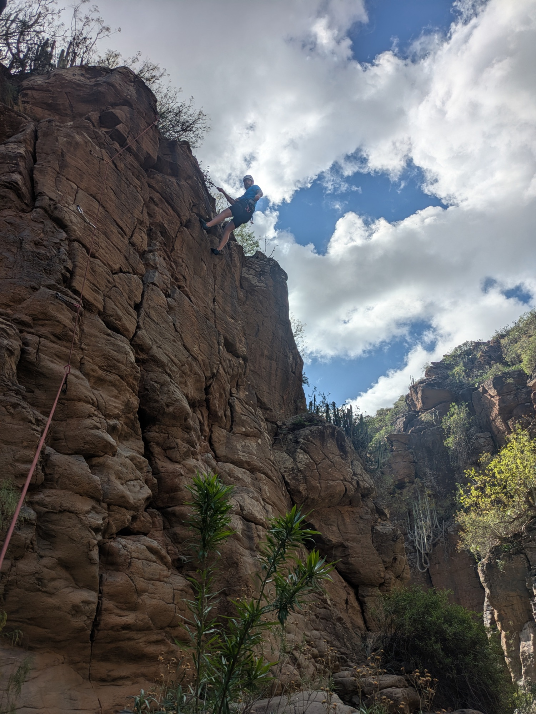

## Cómo se vive

Casi todo el mundo llega un poco nervioso y se va preguntando cuándo puede volver. Los primeros movimientos se sienten raros: la cuerda tirando suavemente del arnés, la roca volcánica rugosa bajo los dedos y el suelo alejándose poco a poco. Tu guía te acompaña en cada paso, desde dónde poner los pies hasta cuándo confiar en la cuerda y echarte hacia atrás. Y entonces, en algún momento de la segunda o tercera vía, todo encaja. Dejas de agarrarte y empiezas a escalar, y la vista sobre el sur de Tenerife es tu premio arriba.

**Estás seguro en todo momento.** Escalas en top-rope, así que la cuerda está anclada por encima de ti y te frena al instante si resbalas. Tu guía te ajusta el arnés y el casco, revisa cada nudo y asegura o supervisa cada vía.

## Qué harás

1. **Conoces a tu guía** en el punto de encuentro, cerca de la zona. Comprobamos tu talla de pie de gato y te ajustamos el arnés y el casco.
2. **Charla de seguridad.** Aprendes cómo funciona el sistema de cuerda, el nudo de ocho y los comandos de escalada.
3. **Primeras vías.** Escalas vías fáciles y bien equipadas en top-rope mientras tu guía te asegura y te corrige los pies.
4. **Aprende a asegurar** (opcional). Si te apetece, aprendes a asegurar a un compañero bajo la supervisión del guía.
5. **Vías más difíciles.** A medida que ganas confianza, pruebas una vía más vertical o más larga.
6. **Repaso final.** Te damos consejos sobre tu técnica y sobre dónde y cómo seguir escalando, además de los siguientes cursos para seguir progresando si te has enganchado.

## Para quién es

- Principiantes absolutos que quieren probar la escalada en roca de verdad
- Escaladores de rocódromo que nunca han escalado fuera
- Parejas, amigos y viajeros que buscan una media jornada activa en Tenerife

## Dónde escalamos

Usamos sectores con vías asequibles, ideales para un primer contacto con la roca, en diferentes zonas de los alrededores de [Arico](/es/zonas-de-escalada/arico/), en el soleado sur de la isla. En verano empezamos temprano para evitar el calor.
