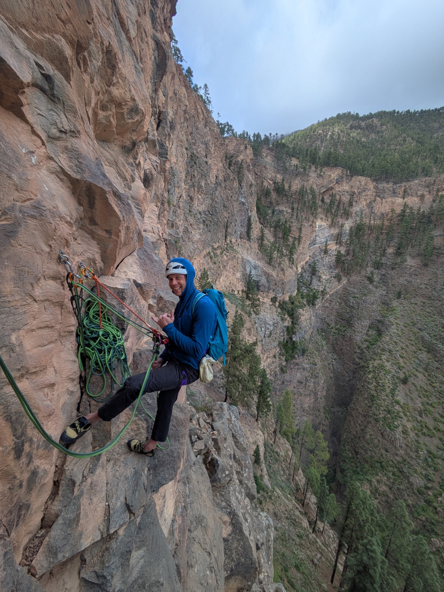

## Cómo se vive

Las sensaciones de las vías largas de aventura son distintas a las de cualquier otra disciplina. La cordada, el compañerismo, la altura bajo los pies, las reuniones en mitad de la pared y la llegada a la cima hacen de esta experiencia algo inolvidable. En Tenerife existen numerosas opciones, tanto en la costa como en el interior.

**Las vías largas exigen experiencia.** Nuestro guía principal es Técnico Deportivo Superior en Escalada (TD3) y ha escalado largas vías de aventura de Yosemite a Kirguistán. Siempre son dos escaladores por guía como máximo; así se ofrece una experiencia personalizada a las necesidades y el nivel de cada participante.

## Las vías

Desde las paredes de Arico, la costa de Taganana y el Parque Nacional del Teide, elegimos la vía en función de tu nivel, el tiempo que haga y la gente que haya en la pared. Consulta nuestras [zonas de escalada](/es/zonas-de-escalada/) para conocer la isla.

## Cómo es el día

1. Salida temprano. Quedamos y vamos en coche hasta la aproximación.
2. Revisión del material y charla sobre maniobras: reuniones, comunicación y rápeles.
3. La escalada, con tu guía de primero o alternando si tienes experiencia.
4. Descenso en rápel o andando, y repaso final.

## Para quién es

Escaladores que ya disfrutan de la escalada deportiva de un largo y quieren la aventura mayor de una vía larga, y cordadas que quieren un guía local para su primera vía larga en Tenerife.
