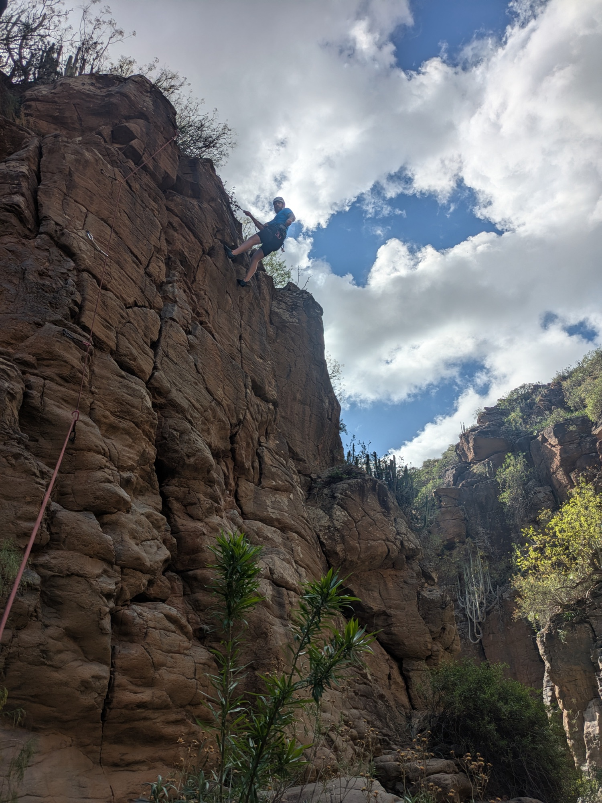

## Ce que l'on ressent

La plupart des gens arrivent un peu nerveux et repartent en demandant quand ils pourront revenir. Les premiers mouvements semblent étranges : la corde qui tire doucement sur le baudrier, la roche volcanique rugueuse sous les doigts et le sol qui s'éloigne peu à peu. Votre guide vous accompagne à chaque étape, de l'endroit où poser les pieds jusqu'au moment de faire confiance à la corde et de vous laisser aller en arrière. Puis, quelque part dans la deuxième ou la troisième voie, le déclic se produit. Vous arrêtez de vous cramponner et vous commencez à grimper, et la vue sur le sud de Tenerife vous attend en haut.

**Vous êtes en sécurité en permanence.** Vous grimpez en moulinette : la corde est ancrée au-dessus de vous et vous retient immédiatement si vous glissez. Votre guide ajuste votre baudrier et votre casque, vérifie chaque nœud et assure ou surveille chaque voie.

## Au programme

1. **Rencontre avec votre guide** au point de rendez-vous près du site. Nous vérifions votre pointure et ajustons baudrier et casque.
2. **Briefing sécurité.** Vous découvrez le fonctionnement de la corde, le nœud de huit et les annonces de grimpe.
3. **Premières voies.** Vous grimpez des voies faciles et bien équipées en moulinette, pendant que votre guide vous assure et vous conseille sur le placement des pieds.
4. **Apprendre à assurer** (facultatif). Si vous le souhaitez, vous apprenez à assurer un partenaire sous la supervision du guide.
5. **Des voies plus difficiles.** À mesure que la confiance s'installe, vous essayez une voie plus raide ou plus longue.
6. **Bilan.** Nous vous donnons des conseils sur votre technique, sur où et comment continuer à grimper, et sur les stages suivants pour progresser si vous avez accroché.

## Pour qui

- Les grands débutants qui veulent essayer l'escalade sur du vrai rocher
- Les grimpeurs de salle qui n'ont jamais grimpé dehors
- Les couples, amis et voyageurs en quête d'une demi-journée active à Tenerife

## Où nous grimpons

Nous utilisons généralement les secteurs faciles et bien équipés de [Tamadaya](/fr/sites-escalade/tamadaya/) et d'[Arico](/fr/sites-escalade/arico/), dans le sud ensoleillé de l'île. En été, nous partons tôt pour éviter la chaleur.
