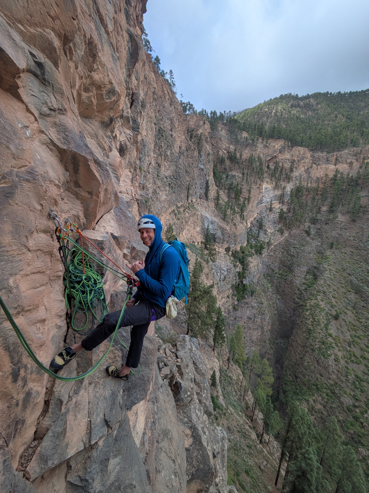

## Ce que l'on ressent

Les sensations des grandes voies d'aventure ne ressemblent à aucune autre discipline. La cordée, la camaraderie, la hauteur sous les pieds, les relais au milieu de la paroi et l'arrivée au sommet en font une expérience inoubliable. Tenerife offre de nombreuses possibilités, sur la côte comme à l'intérieur de l'île.

**Les grandes voies demandent de l'expérience.** Notre guide principal est Técnico Deportivo Superior en Escalada (TD3) et a grimpé de longues voies d'aventure de Yosemite au Kirghizistan. Il y a toujours deux grimpeurs par guide au maximum : l'expérience est ainsi adaptée aux besoins et au niveau de chacun.

## Les voies

Des parois d'Arico à la côte de Taganana et au parc national du Teide, nous choisissons la voie selon votre niveau, la météo et l'affluence sur la paroi. Consultez nos [sites d'escalade](/fr/sites-escalade/) pour découvrir l'île.

## Le déroulement de la journée

1. Départ matinal. Rendez-vous puis route jusqu'à l'approche.
2. Contrôle du matériel et briefing sur les manips : relais, communication et rappels.
3. L'ascension, avec votre guide en tête ou en réversible si vous avez l'expérience.
4. Descente en rappel ou à pied, puis bilan.

## Pour qui

Les grimpeurs qui aiment déjà l'escalade sportive en couenne et veulent l'aventure plus grande d'une longue voie, et les cordées qui veulent un guide local pour leur première grande voie à Tenerife.
