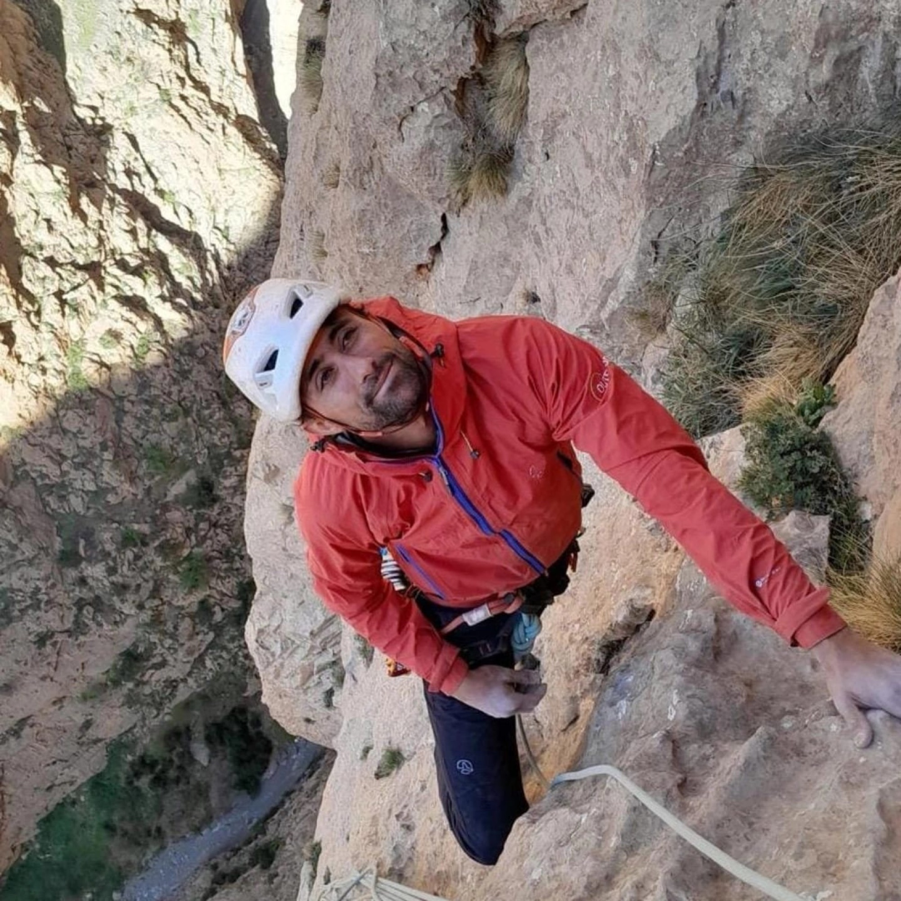

Rocatrips entstand aus einer einfachen Idee: Teneriffa ist einer der besten Orte Europas zum Klettern, und alle, von Einsteigern bis zu erfahrenen Kletterern, sollten es sicher genießen können.

Wir leben und klettern auf der Insel. Wir wissen, welche Wände im Juli morgens Schatten haben, welche Sektoren geschützt bleiben, wenn der Passat weht, und wo Einsteiger ihren besten ersten Tag am Fels erleben.

## Unsere Geschichte

Rocatrips wird von Pablo Vicens geleitet, einem Kletterführer mit 12 Jahren Erfahrung in der Ausbildung von Kletterern und Sportlern am Fels. Er liebt Abenteuerrouten und Big Walls und ist begeisterter Alpinist und Skifahrer. Das Klettern hat ihn von Kirgistan über Marokko bis nach Yosemite geführt. Als Guide hat er auf Teneriffa und auf dem spanischen Festland gearbeitet.

Das Projekt Rocatrips entstand 2023 mit dem Ziel, einwöchige Kletterreisen mit Ausbildungscharakter in Mehrseillängen in verschiedenen Regionen Spaniens und Marokkos anzubieten: von Asturien und Calpe bis zur Todra-Schlucht und nach Taghia.

Die Idee ist dieselbe geblieben: Menschen zeigen, was Teneriffas Basalt sie als Kletterer lehren kann, und jeden von ihnen sicher nach Hause bringen.

## Wie wir führen

- **Dein Tag, dein Niveau.** Jeder Ausflug beginnt mit deiner Erfahrung und deinen Zielen, nicht mit einem festen Programm.
- **Sicherheit zuerst.** Kleine Gruppen, geprüftes Material, Helme und vorsichtige Entscheidungen.
- **Respekt vor dem Fels.** Wir halten uns an Zugangsregeln und Brutsperrungen, haben unsere Genehmigungen in Ordnung und hinterlassen die Felsen sauberer, als wir sie vorgefunden haben.
- **Technisches Wissen teilen.** An jedem Klettertag geben wir weiter, was wir wissen: Technik, Seiltechnik, Sicherheit und wie man den Fels liest, damit du dich als Kletterer weiterentwickelst.

## Unsere Guides

Wir klettern das ganze Jahr auf Teneriffa und führen auf Englisch und Spanisch.

### Pablo Vicens, leitender Guide

<a class="guide-badge" href="https://www.aegm.org/" target="_blank" rel="noopener"><strong>Mitglied der AEGM</strong>Spanischer Bergführerverband · Mitgliedsnr. 1681</a>

- **Técnico Deportivo Superior en Escalada (TD3)**, die höchste Stufe der offiziellen spanischen Kletterführer-Ausbildung
- **Mitglied der AEGM** (Spanischer Bergführerverband), Mitgliedsnr. 1681
- **12 Jahre** Ausbildung von Kletterern und Sportlern am Fels, auf Teneriffa und dem spanischen Festland
- **Abenteuerrouten und Big Walls** von Kirgistan bis Yosemite, über Marokko
- **Gültiges Erste-Hilfe-Zertifikat**

TODO: add Pablo's favourite route in Tenerife and one personal line. Add a profile for any other guide.

Wir nehmen nie mehr als zwei Kletterer pro Guide mit, sind ein registrierter Aktivtourismus-Anbieter auf den Kanaren und haben eine Haftpflicht- und Unfallversicherung. Lies unsere [Sicherheitsstandards](/de/reiseplanung/sicherheit-und-guides/) und [was Kletterer sagen](/de/bewertungen/).

## Fotos

Die Fotos auf dieser Website stammen von unseren eigenen Tagen am Fels. Sieh dir die [Galerie](/de/galerie/) an.
