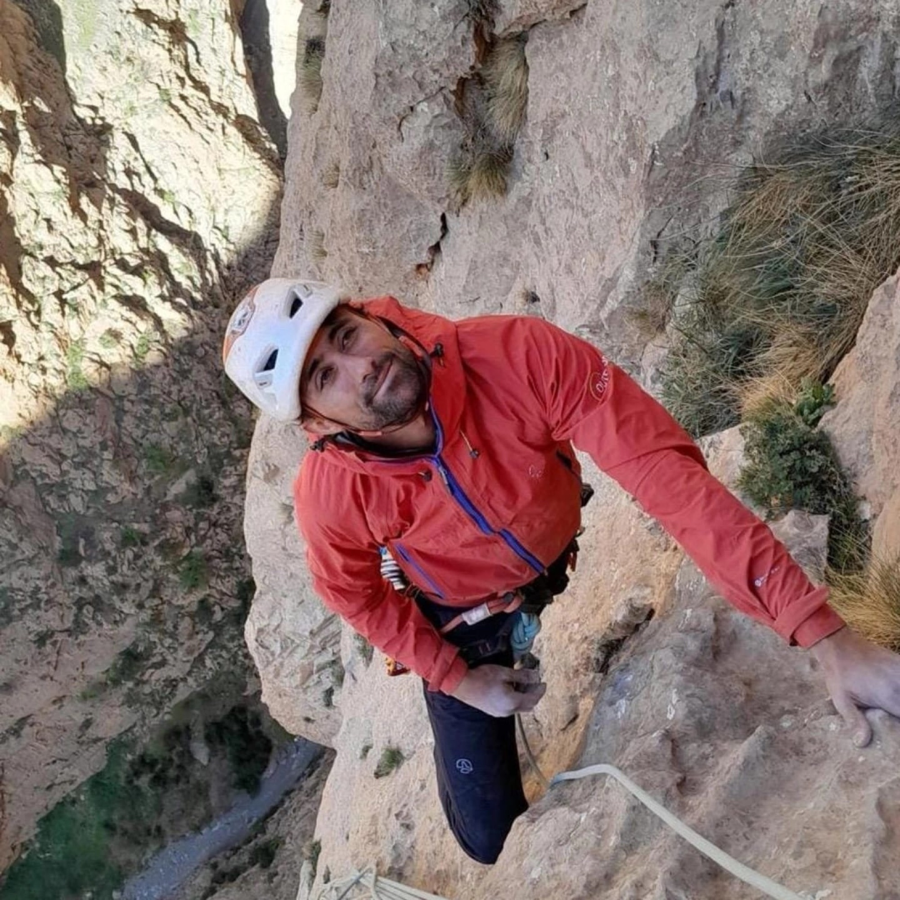

Rocatrips was born from a simple idea: Tenerife is one of the best places in Europe to climb, and everyone, from first-timers to experienced climbers, should be able to enjoy it safely.

We live and climb on the island. We know which walls get the morning shade in July, which sectors stay sheltered when the trade winds blow, and where a beginner will have their best first day on rock.

## Our story

Rocatrips is led by Pablo Vicens, a climbing guide with 12 years of experience training climbers and athletes outdoors. He loves adventure routes and big walls, and is a keen mountaineer and skier. His climbing has taken him from Kyrgyzstan to Yosemite by way of Morocco. As a guide he has worked in Tenerife and mainland Spain.

Rocatrips started in 2023 to offer week-long climbing trips focused on learning multi-pitch climbing in different areas of Spain and Morocco: from Asturias and Calpe to the Todra Gorge and Taghia.

The idea has stayed the same: show people what Tenerife's basalt can teach them as climbers, and bring every one of them home safe.

## How we guide

- **Your day, your level.** Every outing starts with your experience and goals, not a fixed script.
- **Safety first.** Small groups, checked equipment, helmets and conservative decisions.
- **Respect for the rock.** We follow access rules and nesting closures, keep permits in order and leave crags cleaner than we find them.
- **Sharing technical know-how.** On every day out we teach you what we know: technique, rope work, safety and how to read the rock, so you keep growing as a climber.

## Our guides

We climb in Tenerife all year, and we guide in English and Spanish.

### Pablo Vicens, lead guide

<a class="guide-badge" href="https://www.aegm.org/" target="_blank" rel="noopener"><strong>AEGM member</strong>Spanish Mountain Guides Association · Member no. 1681</a>

- **Técnico Deportivo Superior en Escalada (TD3)**, the highest level of Spain's official climbing-guide qualification
- **Member of the AEGM** (Spanish Mountain Guides Association), member no. 1681
- **12 years** training climbers and athletes outdoors, in Tenerife and mainland Spain
- **Adventure routes and big walls** from Kyrgyzstan to Yosemite, by way of Morocco
- **Current first-aid certificate**

TODO: add Pablo's favourite route in Tenerife and one personal line. Add a profile for any other guide.

We never take more than two climbers per guide, we're a registered active-tourism company in the Canary Islands, and we hold civil liability and accident insurance. Read our [safety standards](/plan-your-trip/safety-and-guides/) and [what climbers say](/reviews/).

## Photos

The photos on this site are from our own days at the crags. See the [gallery](/gallery/).
