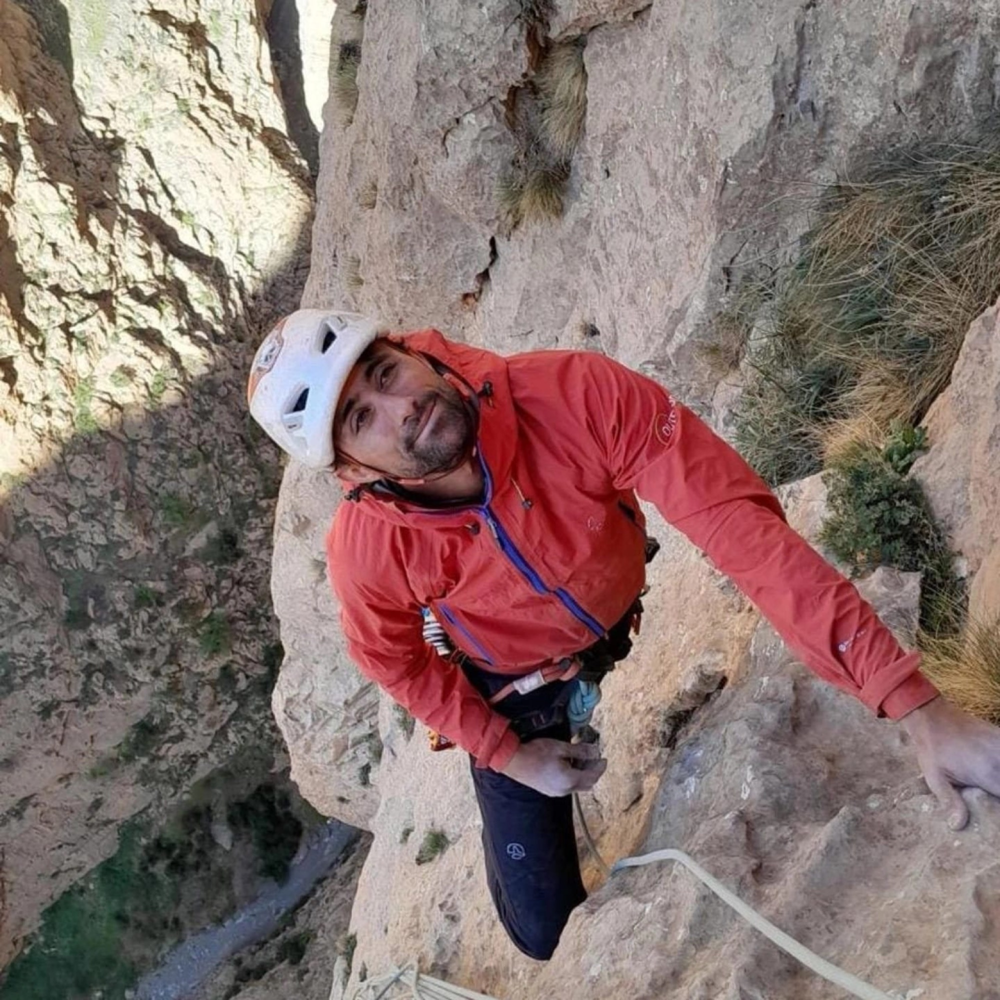

Rocatrips nació de una idea sencilla: Tenerife es uno de los mejores sitios de Europa para escalar, y todo el mundo, desde quien empieza hasta quien tiene experiencia, debería poder disfrutarlo con seguridad.

Vivimos y escalamos en la isla. Sabemos qué paredes tienen sombra por la mañana en julio, qué sectores quedan resguardados cuando sopla el alisio y dónde tendrá alguien su mejor primer día en roca.

## Nuestra historia

Rocatrips está dirigido por Pablo Vicens, guía de escalada con 12 años de experiencia formando a escaladores y deportistas en roca. Le encantan las vías de aventura y las grandes paredes, y es un entusiasta del alpinismo y el esquí. La escalada le ha llevado desde Kirguistán a Yosemite, pasando por Marruecos. Como guía ha trabajado en Tenerife y en la Península.

El proyecto de Rocatrips nació en 2023 con el objetivo de ofrecer trips de escalada de una semana, con carácter formativo, en vías de varios largos en diferentes zonas de España y Marruecos: desde Asturias y Calpe hasta las gargantas del Todra o Taghia.

La idea sigue siendo la misma: enseñar a la gente lo que el basalto de Tenerife puede enseñarles como escaladores, y que todos vuelvan a casa sanos y salvos.

## Cómo guiamos

- **Tu día, tu nivel.** Cada salida parte de tu experiencia y tus objetivos, no de un guion fijo.
- **La seguridad, lo primero.** Grupos pequeños, material revisado, casco y decisiones conservadoras.
- **Respeto por la roca.** Cumplimos las normas de acceso y los cierres por nidificación, tenemos los permisos en regla y dejamos las zonas más limpias de lo que las encontramos.
- **Compartir el conocimiento técnico.** En cada salida te enseñamos lo que sabemos: técnica, maniobras de cuerda, seguridad y cómo leer la roca, para que sigas creciendo como escalador.

## Nuestros guías

Escalamos en Tenerife todo el año y guiamos en inglés y en español.

### Pablo Vicens, guía principal

<a class="guide-badge" href="https://www.aegm.org/" target="_blank" rel="noopener"><strong>Miembro de la AEGM</strong>Asociación Española de Guías de Montaña · Socio nº 1681</a>

- **Técnico Deportivo Superior en Escalada (TD3)**, el nivel más alto de la titulación oficial española de guía de escalada
- **Miembro de la AEGM** (Asociación Española de Guías de Montaña), socio nº 1681
- **12 años** formando a escaladores y deportistas en roca, en Tenerife y en la Península
- **Vías de aventura y grandes paredes** de Kirguistán a Yosemite, pasando por Marruecos
- **Certificado de primeros auxilios vigente**

TODO: add Pablo's favourite route in Tenerife and one personal line. Add a profile for any other guide.

Nunca llevamos más de dos escaladores por guía, somos una empresa de turismo activo registrada en Canarias y tenemos seguro de responsabilidad civil y de accidentes. Lee nuestros [estándares de seguridad](/es/planifica-tu-viaje/seguridad-y-guias/) y [lo que dicen los escaladores](/es/opiniones/).

## Fotos

Las fotos de esta web son de nuestros propios días en la roca. Mira la [galería](/es/galeria/).
