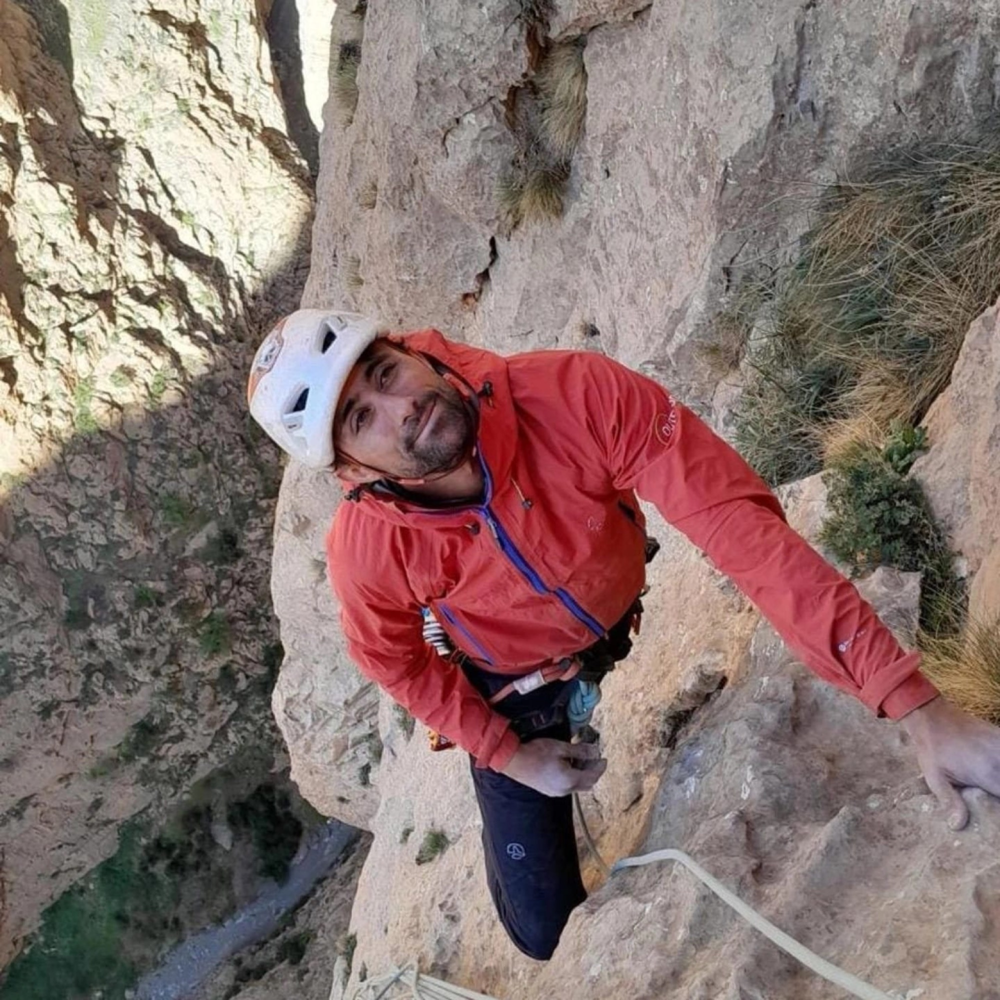

Rocatrips est né d'une idée simple : Tenerife est l'un des meilleurs endroits d'Europe pour grimper, et tout le monde, des débutants aux grimpeurs expérimentés, devrait pouvoir en profiter en toute sécurité.

Nous vivons et grimpons sur l'île. Nous savons quelles parois sont à l'ombre le matin en juillet, quels secteurs restent abrités quand soufflent les alizés, et où un débutant passera sa meilleure première journée sur le rocher.

## Notre histoire

Rocatrips est dirigé par Pablo Vicens, guide d'escalade avec 12 ans d'expérience dans la formation de grimpeurs et de sportifs en falaise. Il adore les voies d'aventure et les big walls, et c'est un passionné d'alpinisme et de ski. L'escalade l'a mené du Kirghizistan à Yosemite en passant par le Maroc. En tant que guide, il a travaillé à Tenerife et en Espagne continentale.

Le projet Rocatrips est né en 2023 pour proposer des séjours d'escalade d'une semaine, axés sur l'apprentissage des grandes voies, dans différentes régions d'Espagne et du Maroc : des Asturies et de Calpe jusqu'aux gorges du Todra et à Taghia.

L'idée n'a pas changé : montrer aux gens ce que le basalte de Tenerife peut leur apprendre en tant que grimpeurs, et ramener chacun d'eux sain et sauf.

## Notre façon de guider

- **Votre journée, votre niveau.** Chaque sortie part de votre expérience et de vos objectifs, pas d'un programme figé.
- **La sécurité d'abord.** Petits groupes, matériel contrôlé, casques et décisions prudentes.
- **Le respect du rocher.** Nous respectons les règles d'accès et les fermetures pour nidification, gardons nos autorisations en règle et laissons les sites plus propres que nous les avons trouvés.
- **Partager le savoir technique.** À chaque sortie, nous vous transmettons ce que nous savons : technique, manips de corde, sécurité et lecture du rocher, pour que vous continuiez à progresser en tant que grimpeur.

## Nos guides

Nous grimpons à Tenerife toute l'année et guidons en anglais et en espagnol.

### Pablo Vicens, guide principal

<a class="guide-badge" href="https://www.aegm.org/" target="_blank" rel="noopener"><strong>Membre de l'AEGM</strong>Association espagnole des guides de montagne · Membre nº 1681</a>

- **Técnico Deportivo Superior en Escalada (TD3)**, le plus haut niveau du diplôme officiel espagnol de guide d'escalade
- **Membre de l'AEGM** (Association espagnole des guides de montagne), membre nº 1681
- **12 ans** à former des grimpeurs et des sportifs en falaise, à Tenerife et en Espagne continentale
- **Voies d'aventure et big walls** du Kirghizistan à Yosemite, en passant par le Maroc
- **Certificat de premiers secours valide**

TODO: add Pablo's favourite route in Tenerife and one personal line. Add a profile for any other guide.

Nous ne prenons jamais plus de deux grimpeurs par guide, nous sommes une entreprise de tourisme actif agréée aux Canaries et nous avons une assurance responsabilité civile et accidents. Lisez nos [normes de sécurité](/fr/preparer-votre-voyage/securite-et-guides/) et [ce qu'en disent les grimpeurs](/fr/avis/).

## Photos

Les photos de ce site viennent de nos propres journées en falaise. Voir la [galerie](/fr/galerie/).
